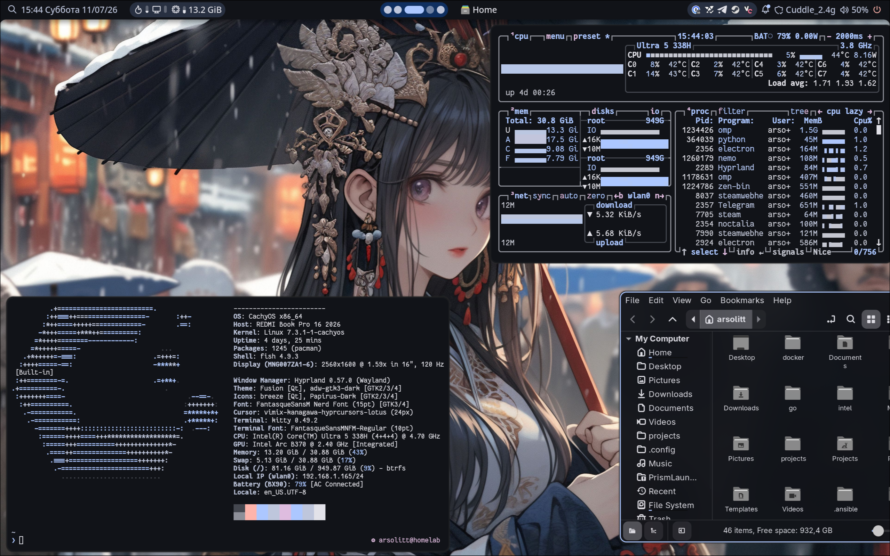
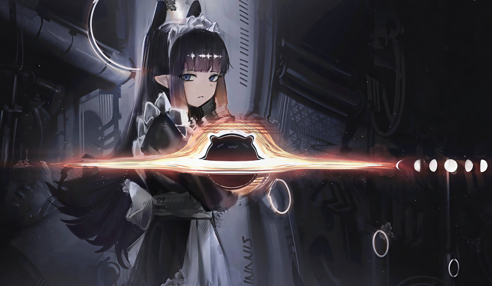

<h1 align="center">dots</h1>

## Install

```fish
sudo pacman -S --needed git fish uv
uv run setup/install.py --list
uv run setup/install.py
```

Hardware steps gate themselves; `--list` shows the detected host, features and
the per-step plan. Per-host profiles live in `setup/devices/<hostname>.toml`.

## Stack

- Hyprland, Lua config (`hypr/`): laptop/desktop module from the DMI chassis type, scrolling layout, `gaming` workspace
- Noctalia shell (`noctalia/`): bar, launcher, control center, notifications, clipboard, wallpaper, session, lock, idle, polkit agent
- Kitty + fish + starship, Kanagawa everywhere
- Nemo + Engrampa (with nemo extensions), Zen, swayimg, nwg-look, hyprpicker
- Screenshots: `hypr/scripts/screenshot.fish` (hyprshot fork) → grim/slurp + satty; Noctalia's own → swash; recording via wf-recorder
- tmux + TPM, neovim (LazyVim), btop
- Mic denoise: `micns` — PipeWire presets or NPU DeepFilterNet3 (`npu-denoise/`)
- 80% battery cap (Xiaomi WMI `WMAA`), ppd `platform_profile` fix, bitland suspend hook
- Fingerprint: fprintd PAM (login/sudo/polkit) + SSH askpass chain in `bin/`
- Docker, SearXNG on `127.0.0.1:8080`, `pbackup` over restic ([recovery](RECOVERY.md))
- Dev: kubectl/kubecm/krew, flux, ansible, go/rust, fnm, uv, sops/age, pass, restic

## Screenshots



## Wallpapers

#### Original

